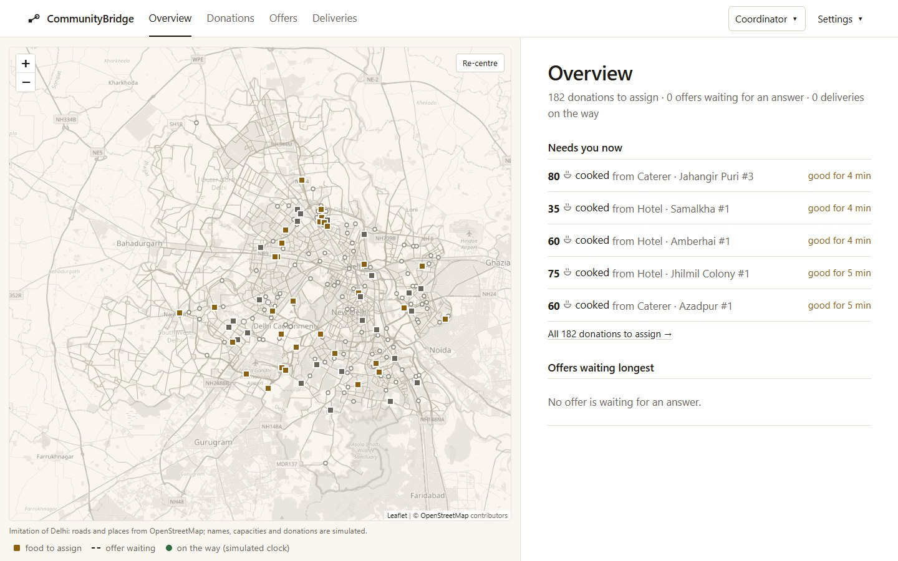
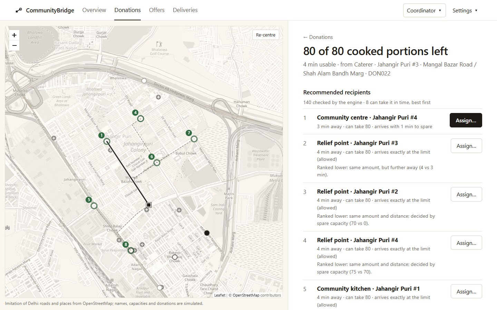
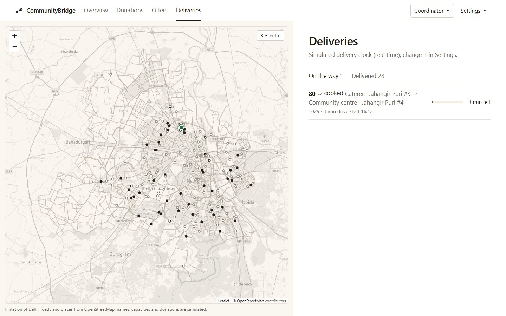
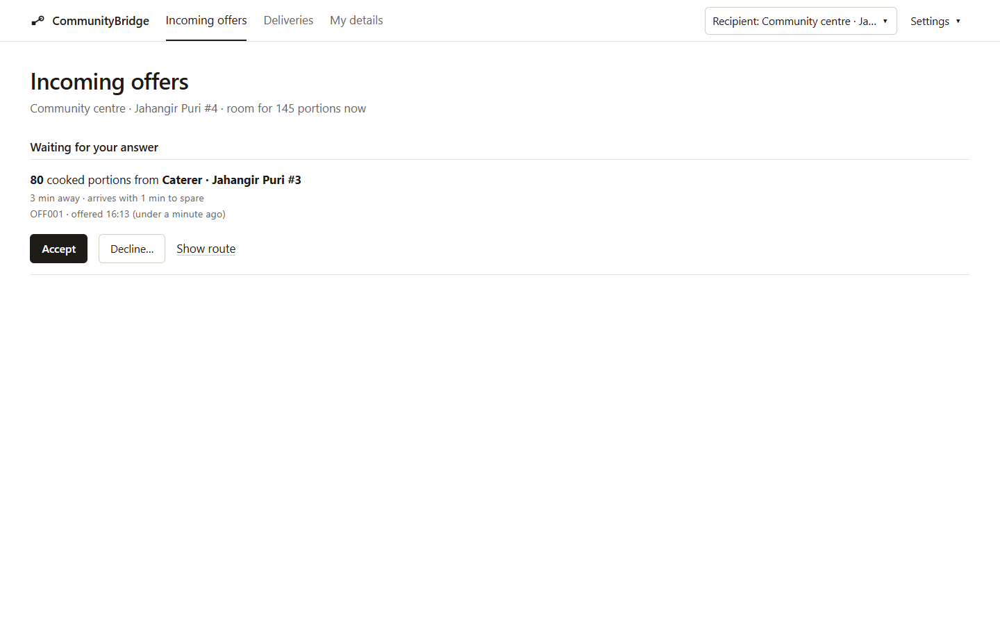
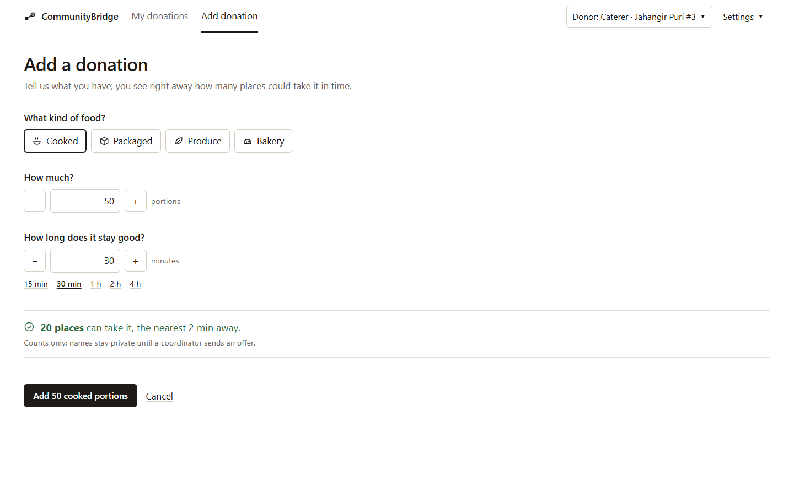
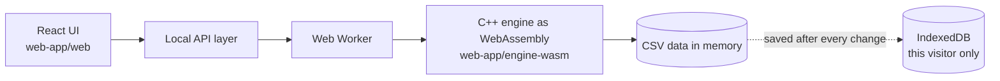

<h1 align="center">CommunityBridge</h1>

<p align="center">
  <b>Surplus food, matched to the kitchens and shelters that can use it before it spoils.</b><br>
  A map-based coordination tool for Delhi, with a C++ decision engine that runs in your browser.
</p>

<p align="center">
  <a href="https://communitybridge-ashy.vercel.app"></a>
</p>

<p align="center">
  
  
  
  
  
  
</p>

<p align="center">
  <a href="https://communitybridge-ashy.vercel.app"></a>
</p>

## The problem

A restaurant, a hotel or a caterer has cooked food that will spoil in a few hours. Nearby kitchens, shelters and food banks could use it, but each has its own limits: how much it can hold, which food it takes, whether it is accepting today, whether it can collect. A coordinator ends up checking all of that by phone and spreadsheet, again and again, while the clock runs.

CommunityBridge does that checking and **explains every decision**: who can take the food in time and in what order, and why each of the others was left out. The coordinator still makes the call.

## Try it in a minute

Open **[communitybridge-ashy.vercel.app](https://communitybridge-ashy.vercel.app)**. Nothing to install and no sign-in.

1. Choose **Coordinator**. The map shows donations that need assigning, the ones that spoil first at the top.
2. Open the first donation. The engine has checked all 140 recipients and lists the ones that can take it in time, best first, with the reason behind each rank.
3. Press **Assign…** on the first recipient, then **Send offer**. It appears under **Offers**.
4. Open the site in a second tab and choose **Recipient**, then that organisation. The offer is waiting; press **Accept**.
5. Back in the coordinator tab, open **Deliveries**. The food is on its way along the real road route.
6. Want to play a donor? Choose **Donor** and use **Add donation**: it shows how many places could take your food as you change the quantity and the time.

Your changes stay in your own browser. **Settings → Reset data** starts over.

## What you see

<table>
  <tr>
    <td width="50%"><a href="web-app/docs/screenshots/match.jpg"></a><br><sub><b>Match a donation.</b> Recipients ranked by the engine, with the route on the map and a plain reason for every rank.</sub></td>
    <td width="50%"><a href="web-app/docs/screenshots/deliveries.jpg"></a><br><sub><b>Deliveries.</b> An accepted offer becomes a delivery that moves along its route on a simulated clock.</sub></td>
  </tr>
  <tr>
    <td width="50%"><a href="web-app/docs/screenshots/recipient-inbox.png"></a><br><sub><b>Recipient.</b> The offer, how far away it is, and how much time is left when it arrives.</sub></td>
    <td width="50%"><a href="web-app/docs/screenshots/donor-add.png"></a><br><sub><b>Donor.</b> Add a donation and see at once how many places could take it in time.</sub></td>
  </tr>
</table>

## How it decides

For a donation, the engine:

1. finds the **travel time** from the donor to every location on the road network (Dijkstra's shortest path),
2. checks each recipient against **six rules**: it is accepting, it takes this kind of food, it has room, it can collect, a road reaches it, and it can be reached within the food's usable time,
3. **ranks** the recipients that pass: more food accepted, shorter travel, less unused capacity, then a fixed tie-break,
4. keeps the **first rule each other recipient fails** as its reason.

A donation can be split between several recipients. The offer, the recipient's answer and the delivery follow.

## How it is built



- **The site is static.** There is no server and no database. The C++ rules engine is compiled to WebAssembly and runs in a Web Worker in each visitor's browser, so every ranking and every rejection reason comes from the C++ code, never from the interface.
- **Each visitor has their own copy of the data**, kept in IndexedDB. Two tabs share it live, so a coordinator tab and a recipient tab can play the whole workflow together.
- **The same engine** also builds as a native program behind a small Node gateway for development. A test compares the two builds byte for byte.
- **Real Delhi.** The `delhi-real` data set uses the real main roads and place locations of all of NCT Delhi from OpenStreetMap, about 2,000 junctions and 3,600 road segments. Organisation names, capacities and donations are simulated; travel minutes come from a speed model per road class.

More detail, commands and the data sets are in [web-app/README.md](web-app/README.md).

## Tech

| Part | Used |
|------|------|
| Interface | React 18, TypeScript (strict), zustand, Leaflet with OpenStreetMap tiles, plain CSS |
| Engine | C++17, compiled with Emscripten to WebAssembly (Web Worker), also a native build |
| Data | Six CSV files per data set, OpenStreetMap roads and places, built with Python scripts |
| Storage | IndexedDB, Web Locks and BroadcastChannel in the browser |
| Hosting | Vercel (static) |

## Run it yourself

You need Node 22 or newer.

```
cd web-app\web
npm ci
npm run dev:local
```

Build and deploy, rebuild the engine, or run the native engine with the gateway: see [web-app/README.md](web-app/README.md) and [web-app/web/DEPLOY.md](web-app/web/DEPLOY.md).

## Repository layout

```
web-app/          the web app and everything behind it
  web/              the site (Vite, React, TypeScript, Leaflet)
  engine-wasm/      the C++ engine as WebAssembly
  engine/           the same engine as a native program
  server/           development gateway (Node, Fastify)
  data/             the three data sets
  tools/            data builders and an independent cross-check
console-app/      the C++ core: data loading and checks, urgency queue, shortest paths, feasibility rules, ranking, allocation
desktop-app/      a Windows desktop version of the same workflow (C++, Win32)
```

The engine compiles `console-app` and the workflow code of `desktop-app` unchanged, so the rules are written once.

## Data and credits

Map data © [OpenStreetMap contributors](https://www.openstreetmap.org/copyright), under the Open Database Licence 1.0. Map tiles come from the public OpenStreetMap tile server, which is meant for light use. All organisation names, capacities and donations are invented.

## Limits

- It is a demo: anyone can pick any role, and there is no sign-in.
- Travel times are modelled from road class and length, not measured traffic.
- Delivery progress is drawn on a simulated clock (1 second is 1 minute, or real time).
