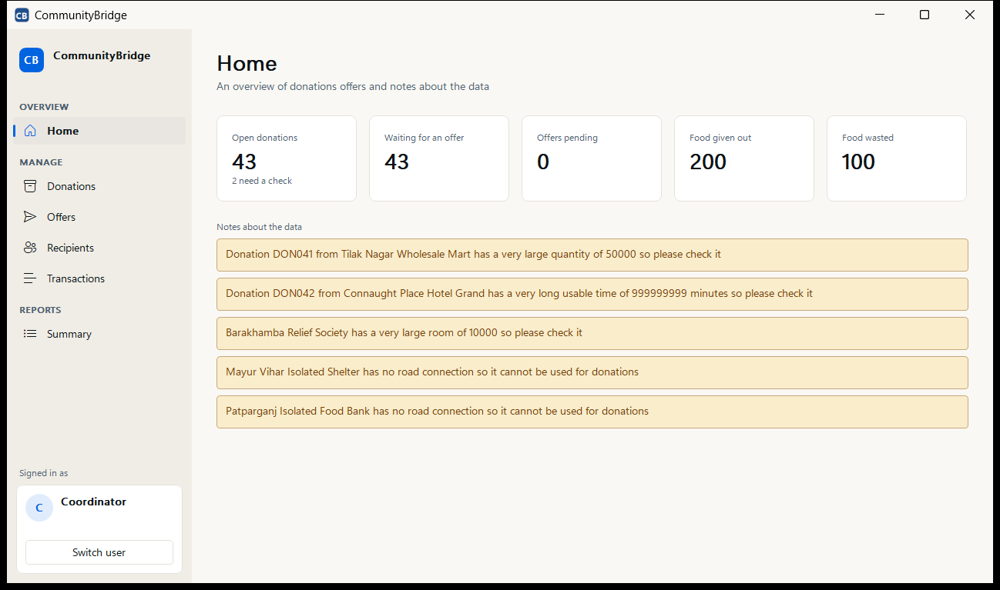
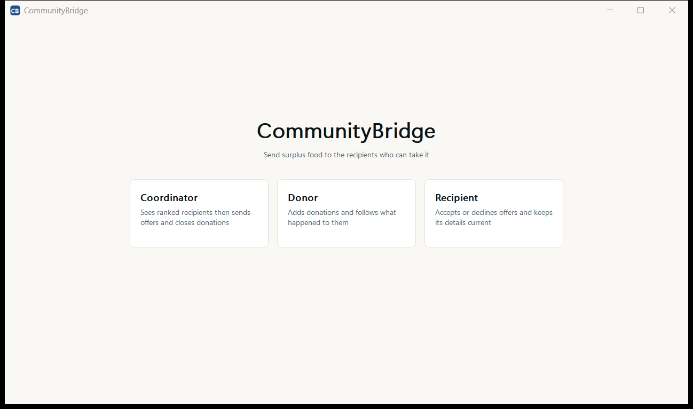
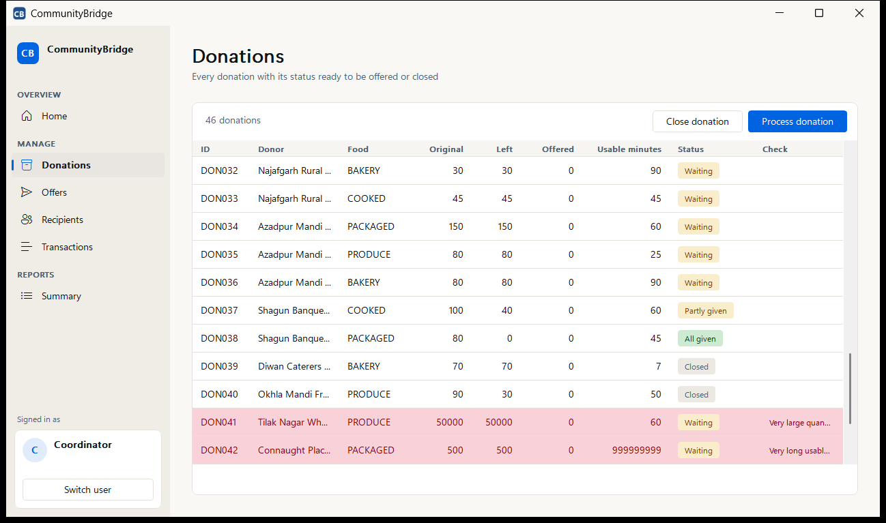
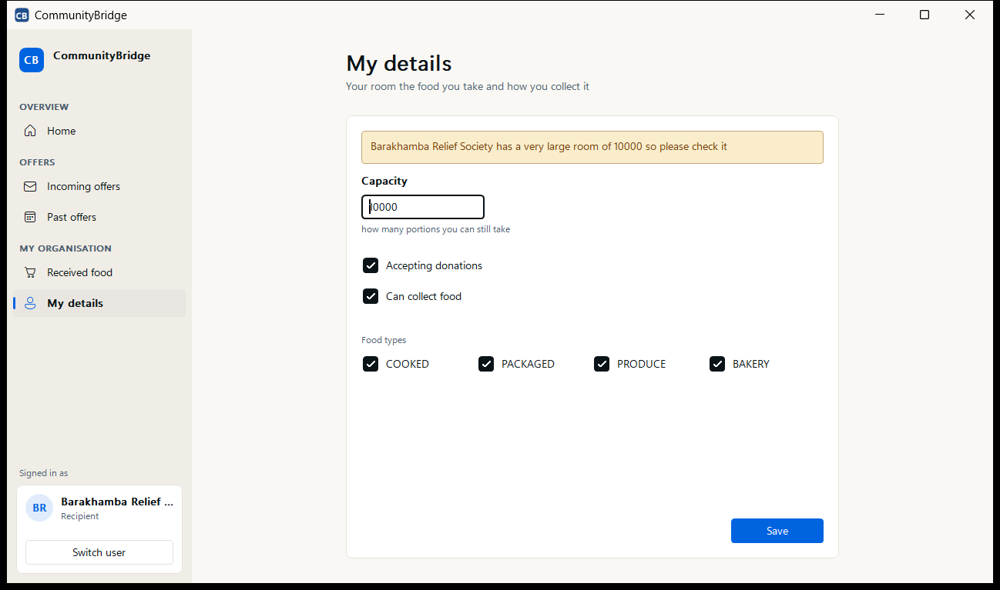

<h1 align="center">CommunityBridge</h1>

<p align="center">
  <b>The system recommends. The coordinator decides.</b><br>
  A food redistribution recommendation system in C++:<br>
  a console program and a Windows desktop app that share the same rules.
</p>

<p align="center">
  
  
  
  
</p>

<p align="center">
  
</p>

## What it does

Food is wasted while nearby organisations go without it. A donor (a restaurant, a hotel, an event organiser) has surplus food that expires soon, and every recipient has different limits: how much it can hold, which food it takes, whether it is accepting, whether it can collect. CommunityBridge does the checking a coordinator would do by phone and spreadsheet:

1. A donor offers food with a quantity, a pickup place and a **usable time** in minutes.
2. **Dijkstra's shortest path** gives the travel time from the donor to every location on a road map.
3. Each recipient is checked against **six feasibility rules**. The first rule that fails is kept as the reason, so a rejection is always explained.
4. The recipients that pass are **ranked**: more food accepted, shorter travel, less unused capacity, smaller id.
5. The coordinator picks a recipient and a quantity. One donation can be **split** between several recipients.
6. The donation and the recipient are updated and the allocation is saved as a **transaction**.

The program only recommends. The final choice is always a person's.

> The travel distances in the sample data are simulated, not real map data.

## The two programs

| Folder | What it is |
|--------|------------|
| [console-app](console-app) | **The console program.** Data loading and checking, urgency order, travel times, feasibility rules, ranking and allocation. The main data structures are written by hand. |
| [desktop-app](desktop-app) | **The Windows desktop app.** Screens for the Coordinator, the Donor and the Recipient. Two interfaces (classic and pro) share one backend. |

The desktop app does not copy the console code. It compiles `console-app/src` directly, so both programs use the same rules and the same data format. For that reason the two folders must stay side by side.

```
console-app/   the rules, the data structures, the CSV files
     |            (its sources are compiled again, read-only, by the desktop app)
desktop-app/   one backend, two interfaces (classic and pro)
```

## The desktop app

<table>
  <tr>
    <td width="50%"><br><sub><b>Welcome.</b> Pick a role, then a name.</sub></td>
    <td width="50%"><br><sub><b>Donations.</b> Status chips, flagged rows for data that needs a check.</sub></td>
  </tr>
  <tr>
    <td width="50%"><br><sub><b>Match a donation.</b> Ranked recipients, and why the others cannot take it.</sub></td>
    <td width="50%"><br><sub><b>Recipient details.</b> Capacity, flags and food types.</sub></td>
  </tr>
</table>

| Role | What they do |
|------|--------------|
| **Coordinator** | Sees donations, matches a donation to ranked recipients, sends or withdraws an offer, closes donations, reads the summary |
| **Donor** | Adds a donation and follows what happened to their donations and offers |
| **Recipient** | Accepts or declines offers, sees past offers and received food, keeps their details up to date |

Offers are soft: the coordinator sends one, the recipient accepts it (this runs the console app's allocation) or declines it. Both interfaces show the same pages and workflows: the **classic** one, and the **pro** one in a calm Windows 11 style (rounded cards, one icon per sidebar item, soft status chips, toasts and a short page fade). Design rules: [desktop-app/docs/DESIGN_GUIDE.md](desktop-app/docs/DESIGN_GUIDE.md).

## Highlights

- **Hand-written data structures:** min-heap priority queue, stack, queue, hash index, merge sort, and a weighted graph with shortest path.
- **Explained decisions:** every rejected recipient carries the reason it was rejected.
- **Safe data handling:** every file is checked at start-up (header, unique ids, references, quantities, statuses) and every save goes through a temporary file, so an interrupted save cannot damage the last good data.
- **One backend, two programs:** the desktop app reuses the console app sources unchanged.
- **Tests at every layer:** one test program per console module, backend tests for the desktop app, and the real window is driven by built-in self-tests that measure the layout at different display scales and walk through the workflows (16 CTest tests).
- **Plain Win32:** no UI framework. The pro interface draws its shapes with GDI+ and its text with GDI (ClearType). No libraries are needed beyond the compiler, and the programs link statically.

## Quick start (Windows)

You need a MinGW g++ with C++17. The desktop app also needs CMake and Ninja.

**The console program** (from the root folder of the repository):

```
.\demo_console.bat
```

It builds the program and runs it on a fresh copy of the sample data, so the real data is never changed.

**The desktop app:**

```
cd desktop-app
.\run_pro.bat
```

It builds the program and opens it. Use `.\run_gui.bat` for the classic interface. `.\reset_data.bat` puts the sample data back. More in [desktop-app/README.md](desktop-app/README.md).

## Repository layout

```
console-app/         console program: src, include, tests, data
desktop-app/         desktop app: src, pro, include, res, tests, data, docs
run_console.bat      build and run the console program on console-app\data
demo_console.bat     build and run the console program on a copy of the data
.clang-format        the code style
.gitignore           build output and packaged apps are not stored here
```

Built programs (`.exe`) are not stored in the repository. Build them with the scripts above.

## Code style

C++17, braces on their own line, 4 spaces, 120 columns. The rules are in [.clang-format](.clang-format). Screen texts carry no punctuation, and the design rules of the desktop app are in [desktop-app/docs/DESIGN_GUIDE.md](desktop-app/docs/DESIGN_GUIDE.md).

## Limits

- Travel times use simulated distances.
- Map locations and roads are added by editing the two map files, not from the program.
- Names cannot contain a comma, because the data files are comma separated.
- The desktop app is Windows only and light mode only.
