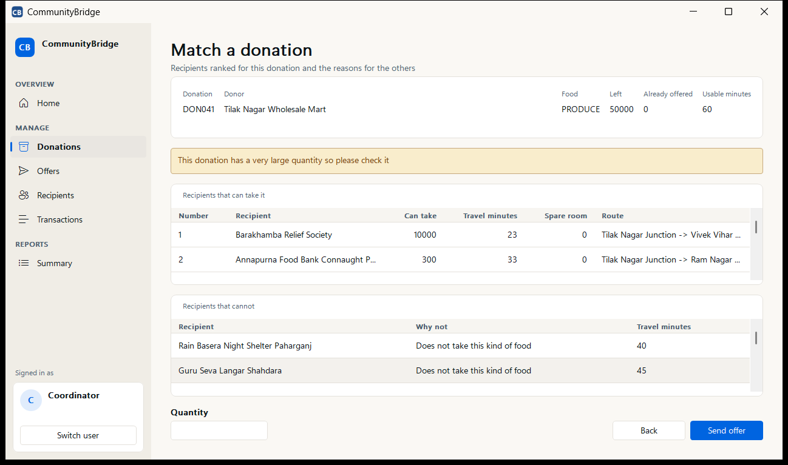

# Desktop app

[Project overview](../README.md) | [< Console app](../console-app/README.md) | **Desktop app**

<p align="center"></p>

The desktop app puts a real Windows window on top of the console app. The three people in the workflow each get their own screens:

| Role | What they do |
|------|--------------|
| **Coordinator** | Sees the donations, matches a donation to ranked recipients, sends an offer, withdraws it, closes donations and reads the summary |
| **Donor** | Adds a donation and follows what happened to their donations and offers |
| **Recipient** | Accepts or declines offers, sees past offers and received food, and keeps their own details up to date |

Offers are soft: the coordinator sends one, the recipient accepts it (this runs the console app allocation) or declines it. The rules, the ranking and the travel times are not rewritten: the desktop app compiles the console app sources from `../console-app/src` and only reads them.

## Two interfaces, one backend

The screenshots in this repository show the pro interface on the sample data. They are in [docs/screenshots](docs/screenshots).

| Program | Look | Start it with |
|---------|------|---------------|
| `communitybridge_gui` | The classic interface | `run_gui.bat` |
| `communitybridge_pro` | A calmer Windows 11 style: rounded cards, a sidebar with one icon per item, soft status chips and toasts, a 120 ms page fade | `run_pro.bat` |

Both show the same pages and use the same data and backend, so every feature and workflow is the same. The pro interface draws its shapes with GDI+ and its text with GDI (ClearType). The design rules are in [docs/DESIGN_GUIDE.md](docs/DESIGN_GUIDE.md).

## Requirements

- Windows (the app is written directly against the Win32 API)
- CMake 3.16 or newer and Ninja
- MinGW g++ with C++17 (developed with MinGW.org GCC 6.3, 32 bit)
- No other libraries. The programs are linked statically.

## Running

Run these from the `desktop-app` folder:

```
.\run_gui.bat       build and start the classic interface on desktop-app\data
.\run_pro.bat       build (Release) and start the pro interface from desktop-app\dist_pro
.\reset_data.bat    put the six sample files back into desktop-app\data and remove offers.csv
```

`run_gui.bat` and `run_pro.bat` build first, so the first start takes a minute or two. The pro interface keeps its own data in `dist_pro\CommunityBridge\data`, so the two interfaces never overwrite each other's changes. To reset the pro data, run `reset_data.bat` inside `dist_pro\CommunityBridge`.

Other scripts:

| Script | What it does |
|--------|--------------|
| `make_dist.bat` | Release build of the classic interface into `dist\CommunityBridge` |
| `make_dist_pro.bat` | Release build of the pro interface into `dist_pro\CommunityBridge` |
| `create_desktop_shortcut.bat`, `remove_desktop_shortcut.bat` | Desktop icon for the classic interface |
| `create_pro_shortcut.bat`, `remove_pro_shortcut.bat` | Desktop icon for the pro interface |

## Tests

```
cmake -G Ninja -S . -B build
cmake --build build
cd build
ctest --output-on-failure
```

- The backend tests run without a window.
- `gui_selftest`, `gui_selftest_flow` and `pro_selftest_flow` start the real program on a copy of the data. They measure the layout (nothing cut off, nothing overlapping, correct at different display scales) and walk through the workflows. They need a normal Windows desktop session.
- Each program also has test switches: `--selftest`, `--selftest-flow`, `--screenshots <folder>`, `--dpi <n>`. The pro program adds `--selftest-dpichange` and `--open <role>/<page>`. A test run writes `selftest.txt` next to the exe.

## Folder layout

```
desktop-app/
  src/        the backend and the classic interface
  include/    headers of src
  pro/        the pro interface (its own src, include and resource file)
  res/        icon, manifest, version resource and the reset script of a packaged app
  tests/      backend tests and the runner of the window tests
  tools/      two small PowerShell helpers (icon, screenshots)
  data/       the six sample files (a copy of console-app/data)
  docs/       design guide, current state, changelog and the notes of the last design round
  CMakeLists.txt
  *.bat       run, package, reset and shortcut scripts
```

## The backend (no windows.h)

| Module | What it does |
|--------|--------------|
| `Workflow` | Every action of the program |
| `Match` | The match view of a donation: ranked recipients and the reasons for the others |
| `Offer`, `OfferStore` | Offers and their file `offers.csv` |
| `Queries` | What each person sees |
| `Dashboard` | The numbers of the Home pages |
| `RecipientUpdate` | Changing a recipient's capacity, flags and food types |
| `Tables` | The text of every list |
| `TextTools` | Small text helpers |

## More documents

- [docs/CURRENT_STATE.md](docs/CURRENT_STATE.md): what is built, page by page
- [docs/CHANGELOG.md](docs/CHANGELOG.md): what changed and when
- [docs/DESIGN_GUIDE.md](docs/DESIGN_GUIDE.md): the design rules
- [docs/MANUAL_CHECKLIST_V2.md](docs/MANUAL_CHECKLIST_V2.md): a checklist to click through by hand
- [docs/ui6/](docs/ui6/): the notes, decisions and known issues of the last design round

## Limits

- Windows only, light mode only
- No search and no sorting in the lists
- Donors and recipients cannot be deleted
- Travel times still use the simulated distances of the sample map

---

Previous: [Console app](../console-app/README.md)
