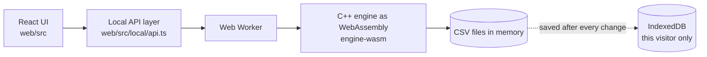

# web-app

The CommunityBridge web app and everything behind it. Live: **https://communitybridge-ashy.vercel.app**

| Folder | What it is |
|--------|------------|
| [web](web) | The site: Vite, React 18, TypeScript, Leaflet. `web/public` holds the shipped engine and data, so Vercel can build from this folder alone. |
| [engine-wasm](engine-wasm) | The C++ engine compiled to WebAssembly with Emscripten. This is what the live site runs. |
| [engine](engine) | The same engine as a native program that speaks JSON lines on stdin and stdout. Used for development and for checking the WebAssembly build. |
| [server](server) | A small Node gateway (Fastify) that supervises the native engine and offers REST and live events. Local development only. |
| [data](data/scenarios) | The three data sets (`lab`, `delhi-geo`, `delhi-real`) as six CSV files each, plus a geometry file for the maps. |
| [tools](tools) | Python scripts that build and validate the data sets (`realmap`, `geo`) and an independent cross-check of the rankings (`oracle`). |
| [scripts](scripts) | PowerShell helpers to build the native engine, start the gateway and reset data. |

## How a request travels



The UI never decides who can take food. It asks the engine, which applies the feasibility rules and the ranking, and it draws the answer. There are two interchangeable back ends, chosen by `VITE_BACKEND` (see `web/src/backend.ts`):

- **`local`** (the live site): the engine runs in the visitor's browser. Data is copied from the packaged data set into IndexedDB on first use and saved after every write. Tabs share one engine through Web Locks and a BroadcastChannel, so a coordinator tab and a recipient tab see each other's changes at once. Nothing is sent to a server.
- **`http`** (development): the browser talks to the Node gateway, which talks to the native engine.

The engine is the same C++ code in both cases. It compiles the rule and data code from `../console-app` and the workflow code from `../desktop-app` without changing them; `engine/BACKEND_MANIFEST.txt` lists the SHA-256 of every file that goes in.

## Data sets

| Name | What it is |
|------|------------|
| `delhi-real` | All of NCT Delhi. Real main roads and real place locations from OpenStreetMap, reduced to about 2,000 junctions and 3,600 road segments. 60 donors, 140 recipients and 200 donations with imitation names (`Type · locality #n`) and simulated capacities. Travel minutes come from a speed model per road class. |
| `delhi-geo` | 20 places in Delhi with real coordinates and road times from a routing service, on the same engine. |
| `lab` | A small synthetic grid with 46 donations and 26 recipients, handy for checking behaviour by hand. |

Every set is the same six CSV files (`donors`, `recipients`, `donations`, `transactions`, `graph_nodes`, `graph_edges`), checked when the engine starts. Map data © OpenStreetMap contributors (ODbL 1.0). Sources and the exact method are in `data/scenarios/*/SOURCES.md` and `SCENARIO_NOTES.md`. The raw OpenStreetMap downloads are not in this repository; `tools/realmap/README.md` explains how to fetch and rebuild them.

## Run it

You need Node 22 or newer.

```
cd web-app\web
npm ci
npm run dev:local        # refreshes public\ (keeps the committed engine if there is no build) and starts the site in local mode
```

Other commands in `web-app\web`:

| Command | What it does |
|---------|--------------|
| `npm run build:vercel` | Type-checks and builds the static site into `dist\` |
| `npm run assets` | Copies the engine build and the data sets into `public\` (a missing source keeps the committed copy, with a warning) and rewrites `public\cb-manifest.json` (content hashes used for caching) |
| `npm run dev:mock` | A mock gateway with fixtures, for working on the UI without an engine |
| `npm run typecheck` | `tsc --noEmit` |

**Deploy to Vercel:** `npx vercel --prod` from `web-app\web` after `npm run assets` and `npm run build:vercel`. Steps and settings are in [web/DEPLOY.md](web/DEPLOY.md).

**Rebuild the WebAssembly engine:** `powershell -File web-app\engine-wasm\build.ps1`. It needs the Emscripten SDK (default folder `%USERPROFILE%\tools\emsdk`, or set `EMSDK`). Run `npm run assets` afterwards to copy the result into `web\public\engine`.

**Native engine and gateway** (development): `powershell -File web-app\scripts\build-engine.ps1`, then `powershell -File web-app\scripts\start-server.ps1`. Both need a MinGW g++. Details are in [engine/README.md](engine/README.md) and [server/README.md](server/README.md).

## Checks that are in the repository

- `engine/tests/test_engine.py`: the engine's commands, errors and rules against the `lab` data.
- `engine-wasm/test/compare.mjs`: the WebAssembly engine against the native one, request by request.
- `server/test/gateway.test.js`: the gateway's routes and role checks (`npm test` in `server`).
- `tools/oracle`: an independent Python re-implementation of the feasibility rules, used to cross-check the engine.
- `tools/realmap/validate_delhi_real.py`: loads and checks the `delhi-real` data set.

## Good to know

- It is a demo. Anyone can pick any role, and there is no sign-in. Data lives only in each visitor's browser; **Reset data** in Settings starts over.
- The map uses the public OpenStreetMap tile server, which is meant for light use. Set `VITE_TILE_URL` at build time to use another tile source.
- Delivery progress runs on a simulated clock (1 second is 1 minute, or real time in Settings). It is a drawing aid; the engine records the accepted offer as a transaction with its travel minutes.
